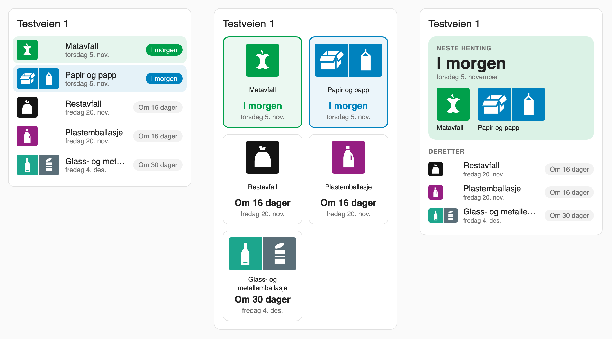

# Hallingdal Renovasjon for Home Assistant

[](https://github.com/slevigen/hallingdal_renovasjon/actions/workflows/validate.yml)
[](https://hacs.xyz/docs/faq/custom_repositories)

Henter tømmeplanen for eiendommen din fra **Hallingdal Renovasjon IKS** og viser
den i Home Assistant som en kalender og som datosensorer, én per avfallstype.

> **Uoffisielt API.** Integrasjonen bruker det samme API-et som mobilappen
> «Hallingdal Renovasjon» (Norconsult ISY ProAktiv). Det er ikke et offentlig,
> dokumentert API for tredjeparter, og det kan endre seg eller slutte å virke
> uten varsel. Integrasjonen er ikke laget av eller tilknyttet Hallingdal
> Renovasjon eller Norconsult.

## Kommuner

Hol, Ål, Gol, Hemsedal, Nesbyen, Flå og Krødsherad.

## Installasjon (HACS)

1. Åpne **HACS** → menyen (⋮) → **Egendefinerte repositorier**.
2. Legg inn `https://github.com/slevigen/hallingdal_renovasjon` med type **Integrasjon**.
3. Søk opp **Hallingdal Renovasjon** i HACS, installer og start Home Assistant på nytt.
4. Gå til **Innstillinger → Enheter og tjenester → Legg til integrasjon → Hallingdal Renovasjon**.
5. Skriv adressen, f.eks. «Storgata 12», og velg riktig eiendom fra listen.

Krever Home Assistant 2026.10 eller nyere. All oppsett skjer i brukergrensesnittet;
det finnes ingen YAML-konfigurasjon.

**Finner ingen eiendom?** Søk på bare begynnelsen av gatenavnet («Storg»).
Registeret skriver ofte «veg» der du skriver «vei», eller omvendt.

Har du flere eiendommer (hjem og hytte), legger du til integrasjonen én gang per
eiendom. Du kan bytte eiendom senere med **Konfigurer på nytt** uten å slette
oppføringen.

## Entiteter

Alle entitetene hører til én enhet per eiendom, oppkalt etter adressen.

| Entitet | Innhold |
|---|---|
| `calendar.<adresse>` | Én heldagshendelse per tømming. Flere avfallstyper samme dag gir flere hendelser. |
| `sensor.<adresse>_restavfall` | Neste dato for restavfall |
| `sensor.<adresse>_matavfall` | Neste dato for matavfall |
| `sensor.<adresse>_papir` | Neste dato for papir og papp |
| `sensor.<adresse>_plast` | Neste dato for plastemballasje |
| `sensor.<adresse>_glass_metall` | Neste dato for glass- og metallemballasje |
| `sensor.<adresse>_neste_henting` | Neste henting uansett avfallstype |

Sensorene for avfallstypene viser sorteringspiktogrammet som bilde (`entity_picture`).
Bildene følger med integrasjonen, så Home Assistant henter ingenting utenfra for å vise dem.

Sensorene er datosensorer (`device_class: date`). Attributter:

- Per avfallstype: `days_until` (dager til neste tømming), `fraction_id`,
  `upcoming` (de neste fem datoene).
- Neste henting: `days_until` og `fractions` (avfallstypene som hentes den dagen).

En tømming som er i dag, regnes som «neste» hele dagen. `days_until` regnes etter
lokal dato i Home Assistant. Planen hentes hver 6. time for 90 dager fram i tid.
Avfallstyper som eiendommen ikke har, får ingen sensor.

## Kort

Integrasjonen har med seg et eget dashbordkort med de offisielle
sorteringsmerkene. Det lastes automatisk, så du trenger ikke legge til noen ressurs.
Velg **Hallingdal Renovasjon** når du legger til et kort, eller skriv YAML:

```yaml
type: custom:hallingdal-renovasjon-card
layout: list   # list, tiles eller next
```



Alle valgene kan også settes i kortets visuelle redigering.

| Valg | Standard | Betydning |
|---|---|---|
| `device_id` | første eiendom | Hvilken eiendom kortet viser |
| `layout` | `list` | `list` (rader), `tiles` (fliser) eller `next` (neste henting stort, resten under) |
| `title` | adressen | Egen tittel |
| `show_title` | `true` | Skjul tittelen med `false` |
| `fractions` | alle | Liste med avfallstyper som skal vises, i ønsket rekkefølge: `restavfall`, `matavfall`, `papir`, `plast`, `glass_metall` |
| `sort` | `date` | `date` (neste først) eller `fixed` (rekkefølgen i `fractions`) |
| `date_format` | `both` | `both` («I morgen» og dato), `relative` eller `date` |
| `highlight_days` | `1` | Uthev tømminger innen så mange dager; `0` slår av |
| `max_items` | ingen | Maks antall avfallstyper |
| `language` | `auto` | `auto` (som Home Assistant), `nb` eller `en` |

Trykk på en rad for å åpne sensoren.

Sorteringsmerkene er brukt med tillatelse.

## Eksempel: varsel kvelden før

```yaml
automation:
  - alias: "Søppelvarsel kvelden før"
    triggers:
      - trigger: time
        at: "19:00:00"
    conditions:
      - condition: template
        value_template: >
          {{ state_attr('sensor.storgata_12_neste_henting', 'days_until') == 1 }}
    actions:
      - action: notify.notify
        data:
          title: "Søppeltømming i morgen"
          message: >
            Sett ut: {{ state_attr('sensor.storgata_12_neste_henting', 'fractions') | join(', ') }}
```

Bytt `storgata_12` med adressen din, slik den står i entitets-ID-en.

## Utvikling

```bash
scripts/setup     # .venv med Home Assistant, pytest, ruff og mypy (Python 3.14)
scripts/lint      # ruff + mypy
.venv/bin/pytest  # tester, kun mot mockede API-svar
scripts/develop   # lokal Home Assistant på http://localhost:8123
```

Notater om API-et: [docs/api.md](docs/api.md).

---

## English summary

Home Assistant custom integration that fetches the waste collection schedule from
Hallingdal Renovasjon IKS (Hol, Ål, Gol, Hemsedal, Nesbyen, Flå and Krødsherad).
Install it as a HACS custom repository, then add it in the UI: type your address
and pick the property. You get a calendar with all upcoming pickups, one date
sensor per waste type, and a "next pickup" sensor with `days_until` and `fractions`
attributes, plus a bundled dashboard card (`custom:hallingdal-renovasjon-card`) with
the official sorting pictograms. It uses the **unofficial** API behind the Hallingdal Renovasjon
mobile app, which may change or stop working at any time.

## Lisens

MIT – se [LICENSE](LICENSE).
